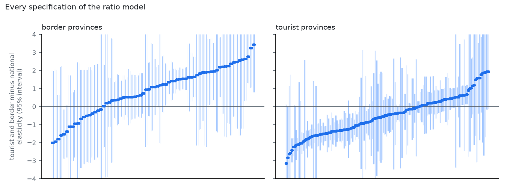

# Tourist and border purchases against residents', by Spanish price

Generated by `python -m analyses.border.run`. See question.md: decisions are parameters and the rules came first.

## Border provinces: **no verdict: price barely moves independently of trend and season**

- 144 specifications of the ratio model. Central 80%: -1.11 to +2.45 (median +1.08); 25% negative; 27% with a 95% interval excluding zero.
- Median HAC s.e. 1.04 (rule: above 0.35 no verdict); median residual spread of log price 0.010 (rule: below 0.02).
- Baseline specification +1.90 (s.e. 1.37); placebo rotations -0.71 to +0.72 (5th-95th percentile), 2% as extreme.

## Tourist provinces: **no verdict: price barely moves independently of trend and season**

- 288 specifications of the ratio model. Central 80%: -1.82 to +0.91 (median -0.47); 66% negative; 33% with a 95% interval excluding zero.
- Median HAC s.e. 0.48 (rule: above 0.35 no verdict); median residual spread of log price 0.010 (rule: below 0.02).
- Baseline specification +0.28 (s.e. 0.61); placebo rotations -0.46 to +0.64 (5th-95th percentile), 35% as extreme.

## Elasticities by outcome

| Group, outcome | Specs | Median | Central 80% | Share negative | CI excludes 0 | Median s.e. |
|---|---|---|---|---|---|---|
| border, ratio | 144 | +1.08 | -1.11 to +2.45 | 25% | 27% | 1.04 |
| border, tourist | 432 | +0.21 | -2.10 to +2.10 | 44% | 19% | 1.28 |
| border, national | 432 | -0.64 | -1.45 to -0.03 | 92% | 54% | 0.38 |
| tourist, ratio | 288 | -0.47 | -1.82 to +0.91 | 66% | 33% | 0.48 |
| tourist, tourist | 864 | -0.76 | -2.89 to +1.10 | 64% | 36% | 0.71 |
| tourist, national | 864 | -0.21 | -1.07 to +0.40 | 62% | 33% | 0.33 |

## Ratio model by group and sample start

| Group, sample start | Specs | Median | Central 80% | Share negative | CI excludes 0 | Median s.e. |
|---|---|---|---|---|---|---|
| border, from 2019-01 | 108 | +1.14 | -0.56 to +2.47 | 22% | 22% | 1.32 |
| border, from 2021-07 | 36 | +0.56 | -1.45 to +1.79 | 33% | 42% | 0.69 |
| tourist, from 2019-01 | 216 | -0.11 | -1.56 to +1.17 | 55% | 13% | 0.75 |
| tourist, from 2021-07 | 72 | -1.46 | -2.09 to -0.88 | 100% | 92% | 0.31 |

The sign can depend on whether the Covid collapse and recovery of tourist and border purchases is in the sample; a post-Covid start leans on the price steps of 2022-23 and 2025, years in which arrivals were also recovering.

## By decision, ratio model

| trend | Specs | Median | Central 80% | Share negative | CI excludes 0 | Median s.e. |
|---|---|---|---|---|---|---|
| linear | 144 | +0.13 | -1.51 to +1.24 | 46% | 34% | 0.34 |
| quadratic | 144 | +0.48 | -1.36 to +2.21 | 36% | 31% | 0.78 |
| cubic | 144 | -1.01 | -2.00 to +1.62 | 75% | 28% | 0.98 |

| covid | Specs | Median | Central 80% | Share negative | CI excludes 0 | Median s.e. |
|---|---|---|---|---|---|---|
| ignore | 216 | -0.90 | -2.03 to +1.59 | 71% | 38% | 0.85 |
| dummy | 108 | +0.46 | -0.80 to +1.94 | 26% | 11% | 0.63 |
| drop | 108 | +0.36 | -1.04 to +1.95 | 41% | 37% | 0.44 |

| lag | Specs | Median | Central 80% | Share negative | CI excludes 0 | Median s.e. |
|---|---|---|---|---|---|---|
| 1 | 144 | -0.52 | -1.80 to +0.59 | 69% | 35% | 0.51 |
| 3 | 144 | +0.07 | -1.58 to +1.91 | 49% | 28% | 0.60 |
| 6 | 144 | +0.47 | -1.60 to +2.22 | 39% | 29% | 0.97 |

| start | Specs | Median | Central 80% | Share negative | CI excludes 0 | Median s.e. |
|---|---|---|---|---|---|---|
| 2019-01 | 324 | +0.20 | -1.35 to +1.91 | 44% | 16% | 0.86 |
| 2021-07 | 108 | -1.33 | -1.95 to +1.24 | 78% | 75% | 0.34 |

| price | Specs | Median | Central 80% | Share negative | CI excludes 0 | Median s.e. |
|---|---|---|---|---|---|---|
| chain_index | 216 | -0.15 | -1.73 to +1.88 | 54% | 33% | 0.69 |
| weighted_mean | 216 | -0.04 | -1.50 to +1.89 | 51% | 28% | 0.63 |

| arrivals | Specs | Median | Central 80% | Share negative | CI excludes 0 | Median s.e. |
|---|---|---|---|---|---|---|
| False | 288 | +0.24 | -1.82 to +1.95 | 45% | 30% | 0.80 |
| True | 144 | -0.39 | -1.51 to +0.64 | 67% | 33% | 0.44 |

## Notes

- A negative differential means tourist and border purchases fall more than residents' when the Spanish price rises.
- The price that matters for cross-border buying is the gap to neighbouring countries' prices, which are not in the data.
- Tourist and border consumption collapsed in 2020 and recovered through 2022; the Covid choices and the arrivals control matter.
