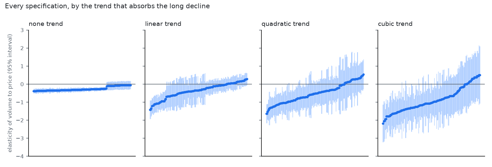

# Market-level elasticity of cigarette volume to price

Generated by `python -m analyses.market.run`. See question.md: every decision is a parameter, the verdict rules were written first.

## Verdict

**no elasticity reported: price barely moves independently of trend and season**

- 864 specifications. Central 80% of estimates: -1.29 to +0.10 (median -0.36); 86% negative; 46% have a 95% interval excluding zero.
- Median HAC standard error 0.31 (rule: above 0.35 the data cannot separate -0.3 from -1).
- Median residual spread of log price after trend and season 0.011 (rule: below 0.02 means no independent price variation).
- Baseline specification: -0.51 (s.e. 0.27); placebo rotations of the price series give -0.09 to +0.28 (5th to 95th percentile), and 2% of them are at least as extreme.

## Does the verdict depend on the thresholds of the rules?

The two numeric thresholds were fixed before the run, but they are decisions too. The same specifications under other values:

| Residual log-price spread needed | Max s.e. allowed | Verdict |
|---|---|---|
| 0.005 | 0.25 | no elasticity reported: too imprecise to tell inelastic from unit elastic |
| 0.005 | 0.35 | not determined by the data |
| 0.005 | 0.5 | not determined by the data |
| 0.01 | 0.25 | no elasticity reported: too imprecise to tell inelastic from unit elastic |
| 0.01 | 0.35 | not determined by the data |
| 0.01 | 0.5 | not determined by the data |
| 0.02 | 0.25 | no elasticity reported: price barely moves independently of trend and season |
| 0.02 | 0.35 | no elasticity reported: price barely moves independently of trend and season |
| 0.02 | 0.5 | no elasticity reported: price barely moves independently of trend and season |
| 0.03 | 0.25 | no elasticity reported: price barely moves independently of trend and season |
| 0.03 | 0.35 | no elasticity reported: price barely moves independently of trend and season |
| 0.03 | 0.5 | no elasticity reported: price barely moves independently of trend and season |

## By decision

| trend | Specs | Median elasticity | Share negative | Median s.e. |
|---|---|---|---|---|
| none | 216 | -0.30 | 100% | 0.06 |
| linear | 216 | -0.34 | 79% | 0.22 |
| quadratic | 216 | -0.52 | 81% | 0.37 |
| cubic | 216 | -1.04 | 86% | 0.54 |

| price | Specs | Median elasticity | Share negative | Median s.e. |
|---|---|---|---|---|
| chain_index | 432 | -0.38 | 89% | 0.29 |
| weighted_mean | 432 | -0.35 | 84% | 0.33 |

| volume | Specs | Median elasticity | Share negative | Median s.e. |
|---|---|---|---|---|
| per_month | 288 | -0.37 | 86% | 0.32 |
| per_weekday | 288 | -0.36 | 85% | 0.29 |
| per_monsat_day | 288 | -0.34 | 88% | 0.32 |

| covid | Specs | Median elasticity | Share negative | Median s.e. |
|---|---|---|---|---|
| ignore | 432 | -0.58 | 97% | 0.35 |
| dummy | 216 | -0.34 | 86% | 0.25 |
| drop | 216 | -0.33 | 66% | 0.25 |

| stock | Specs | Median elasticity | Share negative | Median s.e. |
|---|---|---|---|---|
| ignore | 288 | -0.36 | 86% | 0.31 |
| dummy | 288 | -0.36 | 86% | 0.30 |
| drop | 288 | -0.36 | 86% | 0.30 |

| lag | Specs | Median elasticity | Share negative | Median s.e. |
|---|---|---|---|---|
| 1 | 288 | -0.78 | 99% | 0.29 |
| 3 | 288 | -0.43 | 94% | 0.28 |
| 6 | 288 | -0.14 | 67% | 0.38 |

| start | Specs | Median elasticity | Share negative | Median s.e. |
|---|---|---|---|---|
| 2019-01 | 648 | -0.34 | 82% | 0.34 |
| 2021-07 | 216 | -0.83 | 99% | 0.27 |

## Notes

- Elasticity is the change in log volume per day for a change in log price index; -0.5 means a 10% price rise goes with 5% less volume.
- Volume is sell-in to tobacconists. A smoker's response and a retailer's stock decision are not separated.
- The trend and the price both move slowly, which is why the estimate leans on the three price steps and why the choice of trend matters most.
