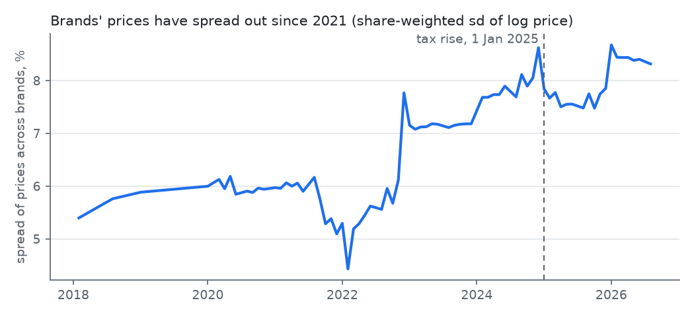
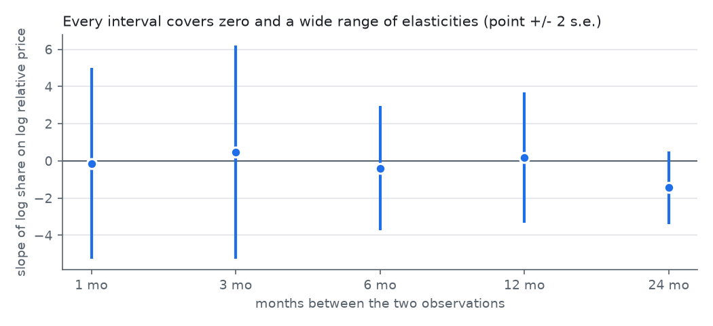

# Brand panel: price and share, a first look

Generated by `python -m analyses.panel.run`. See question.md.

## The panel

- 1277 brand-months, 48 brands, 75 months (2018-02 to 2026-08).
- Month-on-month change in a brand's price relative to the market: standard deviation 1.0%. Only 66 of 1003 brand-month changes exceed 2%.

Prices mostly move together. The variation that could identify an elasticity (a brand repricing against the others) is small next to the month-to-month noise in shares.

## Is the spread of prices compressing?

Spread: 5.4% in 2018-02, 5.1% in 2021-12, 8.6% in 2024-12, 7.8% in 2025-01, 7.8% in 2025-03, 8.3% in 2026-08.

At the 1 January 2025 tax rise the spread stepped down from 8.6% to 7.8% and stayed there to March, which is the direction the tariff structure predicts (cheap packs rise most). Over 2021-2026 the spread widened overall. That measure mixes brands repricing with changes in which brands are on the list; I have not separated the two.
The largest single step, in December 2022, is repricing: Marlboro 5.04 -> 5.34; Camel 4.84 -> 5.13; Bullbrand 4.07 -> 4.06 (premium brands up about 6%, the cheap one flat).

## Share against relative price

| Months apart | n | Brands | Slope | s.e. (clustered by brand) | 95% interval |
|---|---|---|---|---|---|
| 1 | 1003 | 36 | -0.13 | 2.57 | -5.3 to +5.0 |
| 3 | 961 | 35 | +0.47 | 2.87 | -5.3 to +6.2 |
| 6 | 913 | 35 | -0.39 | 1.67 | -3.7 to +3.0 |
| 12 | 835 | 26 | +0.19 | 1.76 | -3.3 to +3.7 |
| 24 | 673 | 22 | -1.44 | 0.98 | -3.4 to +0.5 |

## Reading

- A plain fixed-effects slope of share on relative price cannot tell an elasticity of -4 from +4 here. At short lags prices barely move; at long lags the estimate changes with the horizon and the intervals still cover zero.
- This is a result about the data, not about smokers: national tax changes move all prices together, and brands rarely reprice against one another by more than a point or two a month.
- Ways to get more out of it: model the mechanism (shares as a choice model with brand effects), use the tax-implied price change as an instrument for the part of a brand's repricing that the tax forces by tier, and bring in regional or age structure. Each needs its own identifying assumption, stated up front.
