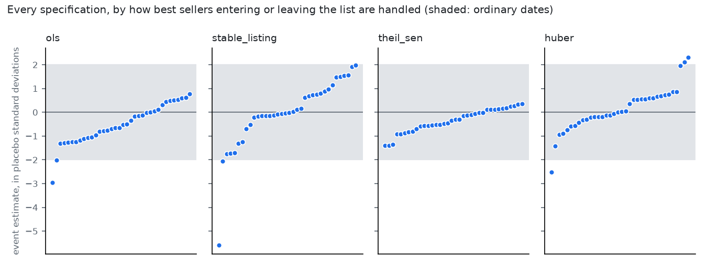

# Share against the tax-forced price change (January 2025)

Generated by `python -m analyses.taxshock.run`. See question.md: every decision is a parameter and the whole grid is run.

## Verdict, by the rules fixed in question.md

- 144 specifications; 27 (19%) have a first stage between 0.5 and 1.5. The median first stage over all of them is +0.30.
- Sign of the reduced form: **no verdict: too few specifications have a first stage**.
- Outside +/-2 placebo standard deviations: 0% of usable specifications -> not distinguishable from background.

## By handling of list artefacts

| Handler | Specs | Median reduced form | Share negative | Median first stage | Median z | Share outside band |
|---|---|---|---|---|---|---|
| ols | 36 | -2.6 | 67% | +0.28 | -0.6 | 6% |
| stable_listing | 36 | +1.1 | 42% | +0.08 | -0.0 | 6% |
| theil_sen | 36 | -1.5 | 67% | +0.67 | -0.3 | 0% |
| huber | 36 | +0.5 | 33% | +0.26 | +0.0 | 8% |

## By weighting of brands

| Weighting | Specs | Median reduced form | Share negative | Median first stage | Median z | Share outside band |
|---|---|---|---|---|---|---|
| equal | 72 | -0.1 | 54% | +0.35 | -0.2 | 7% |
| pre_share | 72 | -0.2 | 50% | +0.24 | +0.1 | 3% |

## By window

| Window | Median reduced form | Share negative | Median z |
|---|---|---|---|
| Oct-Nov / Mar-May | -1.0 | 75% | -0.2 |
| Jul-Nov / Mar-Aug | -0.7 | 50% | -0.3 |
| Oct-Nov / Jun-Sep | -5.5 | 62% | -1.2 |
| Oct-Nov / Jan-Mar | +1.2 | 12% | +0.2 |
| Sep-Nov / Apr-Jul | -1.6 | 75% | -0.4 |
| Nov / Mar | +0.4 | 38% | +0.0 |

## Brands behind the first window (pre 2024-10..2024-11, post 2025-03..2025-05)

| Brand | Change in log share | Listing stable |
|---|---|---|
| KING | -79.0% | yes |
| LUCKY STRIKE | -64.8% | no |
| NOBEL | -50.6% | no |
| CAMEL | -12.6% | no |
| WINSTON CLASSIC | -10.6% | yes |
| CHESTERFIELD | -10.5% | yes |
| HERENCIA | -10.0% | no |
| DUCADOS NEGRO | -6.5% | yes |
| FORTUNA | -4.6% | yes |
| BN | -4.5% | yes |
| BULLBRAND | +1.7% | yes |
| DUCAL | +15.7% | no |
| MARLBORO | +18.9% | no |
| WINSTON | +23.4% | no |
| WEST BROOKLYN | +25.0% | yes |

## Notes

- z = (event estimate - placebo mean) / placebo standard deviation, for the same specification.
- A first stage outside 0.5-1.5 means brands' relative prices did not move as the tax implies, so the ratio of reduced form to first stage is not read as an elasticity.
- Cheap brands are the most forced; the design cannot separate their price response from anything else that moved cheap brands differently in these months.
