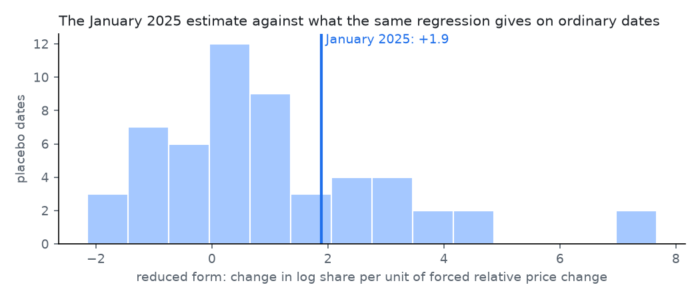

# Share against the tax-forced price change (January 2025)

Generated by `python -m analyses.taxshock.run`. See question.md for the design and its assumption.

| Window | n brands | Reduced form (s.e.) | First stage (s.e.) | IV | Placebo dates | Placebo sd | Share of placebos at least as extreme |
|---|---|---|---|---|---|---|---|
| main: Oct-Nov before, Mar-May after | 14 | -2.5 (3.5) | +0.35 (0.29) | -7.1 | 54 | 9.0 | 41% |
| main: Oct-Nov before, Mar-May after, trimmed | 12 | +1.9 (1.4) | +0.63 (0.18) | +3.0 | 54 | 2.0 | 31% |
| longer before: Jul-Nov, Mar-Aug after | 14 | -4.3 (5.1) | +0.26 (0.29) | -16.7 | 55 | 8.2 | 20% |
| longer before: Jul-Nov, Mar-Aug after, trimmed | 12 | +2.3 (1.4) | +0.51 (0.22) | +4.6 | 55 | 2.0 | 24% |
| later after: Jun-Sep | 13 | -9.6 (7.7) | +0.38 (0.32) | -25.5 | 51 | 9.3 | 6% |
| later after: Jun-Sep, trimmed | 11 | +1.3 (1.9) | +0.73 (0.14) | +1.8 | 51 | 2.1 | 43% |

## Brands in the main window (pre 2024-10..2024-11, post 2025-03..2025-05)

| Brand | Forced relative change | Actual relative price change | Change in log share |
|---|---|---|---|
| BULLBRAND | +7.2% | +5.8% | +1.7% |
| KING | +7.1% | -1.3% | -79.0% |
| DUCAL | +3.8% | +0.4% | +15.7% |
| WEST BROOKLYN | +1.5% | -1.7% | +25.0% |
| FORTUNA | +0.6% | +1.8% | -4.6% |
| WINSTON | +0.6% | +1.2% | +23.4% |
| LUCKY STRIKE | -0.1% | -3.0% | -64.8% |
| CAMEL | -0.7% | +1.9% | -12.6% |
| WINSTON CLASSIC | -0.7% | +1.0% | -10.6% |
| CHESTERFIELD | -0.9% | +0.9% | -10.5% |
| DUCADOS NEGRO | -0.9% | -0.1% | -6.5% |
| BN | -1.2% | -0.2% | -4.5% |
| MARLBORO | -1.2% | -3.5% | +18.9% |
| HERENCIA | -1.6% | -3.1% | -10.0% |

## Reading

- All brands, main window: first stage +0.35 (s.e. 0.29); values near 1 mean brands' relative prices moved as the tax implies.
- All brands, main window: reduced form -2.5; ordinary dates scatter with a standard deviation of 9.0, and 41% of them are at least as extreme.
- Leaving out brands whose log share moved by more than 0.5 (King, Lucky Strike: a tier row entering or leaving the best-seller list looks like a collapse or a surge): reduced form +1.9 (s.e. 1.4), first stage +0.63, 31% of placebo dates as extreme.
- The sign is the point: once those are out the share of the most-forced (cheapest) brands went up (+1.9), not down as an own-price elasticity would have it. Trading down after a general price rise, or an existing drift towards cheap brands, would look the same; this design cannot tell them apart.
- On ordinary dates the same regression averages +1.0: brands that this tariff would push hardest (the cheap ones) tend to gain share anyway, a background drift the estimate has to be read against.
- Either way the event sits inside the spread of the placebo dates, so the January 2025 tax change does not give a usable estimate of how share responds to a brand's relative price. The IV ratio is shown because it is what the design computes, not because it is an elasticity.
- Cheap brands are the most forced; the design cannot separate their price response from anything else that moved cheap brands differently in these months.
